<p align="center">
  
</p>

<h1 align="center">Fawa2ly · فوقلي</h1>

<p align="center">
  <b>The interview assistant that listens to the call, catches the question, and shows you what to say, in a couple of seconds.</b>
</p>

<p align="center">
  
  
  
  
</p>

<div dir="rtl" align="center">

**فوقلي** مساعد لمقابلات العمل: بيسمع المكالمة، يلقط السؤال أول ما يتسأل، ويكتبلك على الشاشة جمل قصيرة تقولها، من سيرتك الذاتية وبكلامك، بالعربي أو الإنجليزي.

</div>

---

Your mind goes blank halfway through an interview question. Fawa2ly is for that moment. It sits in a
small window on top of your call, hears the other side, notices when they ask you something, and
writes three to five short lines you can say out loud, grounded in your own CV. You keep talking; it
keeps up.

It runs on your own API keys (or fully on your machine), keeps your documents on your computer, and
records nothing unless you turn that on.

> **Status: early.** The engine and its 400+ tests are solid and the overlay has been used on real
> calls, but the Windows installer has had little testing outside the author's machine. Expect
> rough edges, and please report them.

## Contents

[Why the name](#why-fawa2ly) · [Who it's for](#who-its-for) · [How it works](#how-it-works) ·
[A tour](#a-tour) · [Features](#features) · [Hotkeys](#hotkeys) · [Privacy](#privacy-stated-plainly) ·
[What it will not do](#what-it-will-not-do) · [Install](#install-windows) ·
[Your first call](#your-first-call) · [Run from source](#run-it-from-source) ·
[Under the hood](#under-the-hood) · [Status and limits](#status-and-known-limits)

## Why "Fawa2ly"?

*Fawa2ly* (فوقلي) is Egyptian Arabic for "snap me out of it". The name comes from a TikTok bit where
someone squeezes a red stretchy toy monster and shouts *"فوقلي! فوقلي!"* at it. That toy became the
app's mascot and its whole look: the red of its skin, the yellow of its chest, its goofy googly eyes.
The mascot sits in the corner of the overlay and its face tells you what the app is doing.

<p align="center">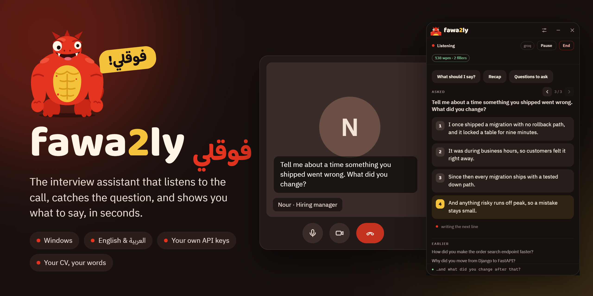</p>

## Who it's for

- **Job seekers in online interviews.** HR screens, technical interviews, panel calls: anywhere a
  question can catch you off guard. There are 60+ role presets, from backend developer and data
  analyst to nurse, pharmacist, cabin crew, teacher and graduate.
- **People interviewing in their second language.** Arabic speakers interviewing in English, or
  anyone interviewing in Egyptian or Modern Standard Arabic. The whole app also runs in Arabic,
  right to left.
- **People who freeze under pressure.** You know the answer; you just need the first line. The
  lines come from your CV, so they sound like you and the facts are yours.
- **Career changers and graduates**, who have the experience but not yet the words for it. Each has
  its own preset.
- **Professionals in meetings.** A Meeting mode, with presets for client calls, one-to-ones and
  stand-ups, plus a recap and notes afterwards.
- **Privacy-minded users.** Bring your own key for any of a dozen providers, or run everything
  locally with Whisper and Ollama, so nothing from your calls leaves the machine (see
  [Privacy](#privacy-stated-plainly) for what the app itself downloads: fonts, updates, the Whisper model).

It is **not** for situations where outside help is forbidden. Fawa2ly does not hide from screen
sharing or proctoring software, by design: see [What it will not do](#what-it-will-not-do).

## How it works

<p align="center">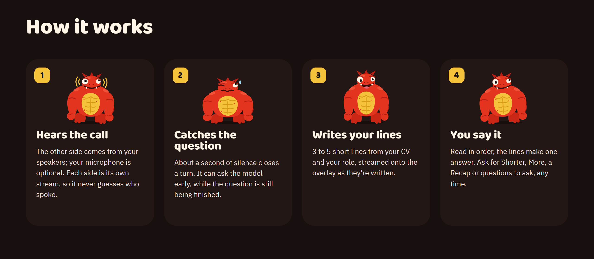</p>

1. **It hears the call.** The other side comes from your speakers (Windows loopback audio); your
   microphone is optional context. Each side is its own stream, so it never has to guess who spoke.
2. **It catches the question.** Speech becomes text as it is spoken. About a second of silence
   closes a turn, and a detector decides whether it was a question or a request. It can ask the
   model early, while the question is still being finished.
3. **It writes your lines.** Your role, your documents and the last few turns go to the model you
   chose. Three to five lines of at most 20 words stream onto the overlay as they are written, and a
   guardrail drops anything too long, repeated, or shaped like a CV heading.
4. **You say it.** Read in order, the lines form one answer. Ask for **Shorter**, **More**, a
   **Recap**, **Questions to ask** or **What should I say?** at any time, by button or hotkey.

## A tour

The screens below are the real app, captured from this repository with an example call (a
fictional backend engineer, [docs/sample_cv.txt](docs/sample_cv.txt)).

<table>
  <tr>
    <td align="center" width="33%">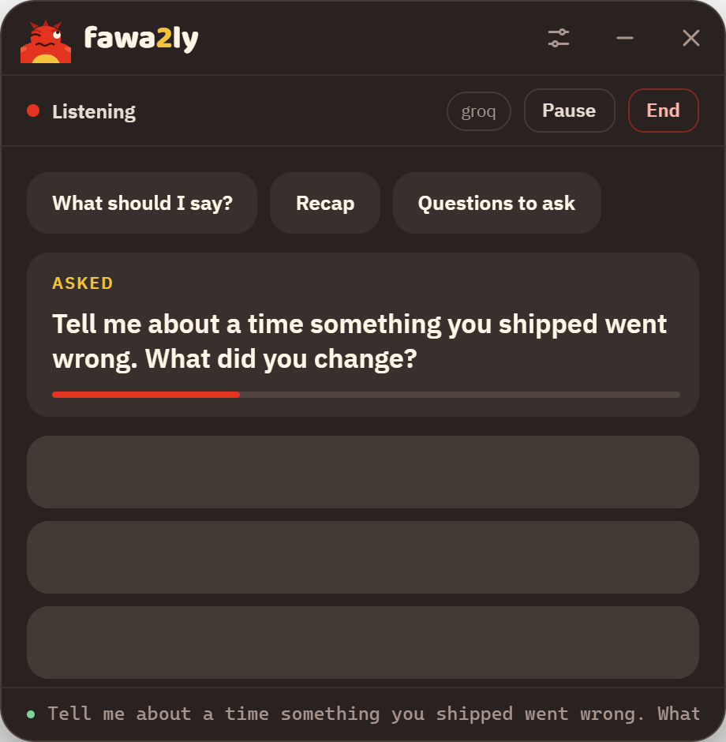<br><sub><b>Caught.</b> The question is on screen and the mascot is thinking.</sub></td>
    <td align="center" width="33%">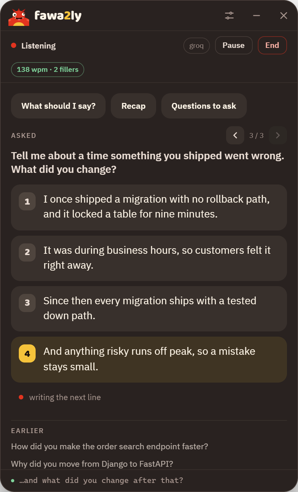<br><sub><b>Answered.</b> The newest line wears the toy's yellow chest.</sub></td>
    <td align="center" width="33%">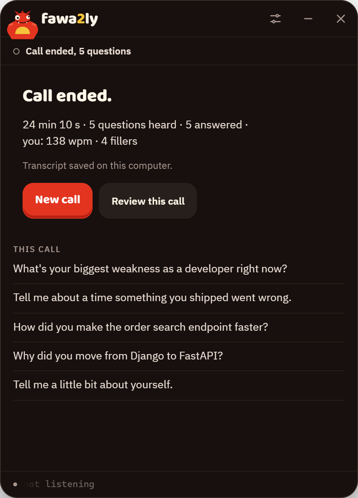<br><sub><b>After the call.</b> A summary, every question, and a review.</sub></td>
  </tr>
  <tr>
    <td align="center">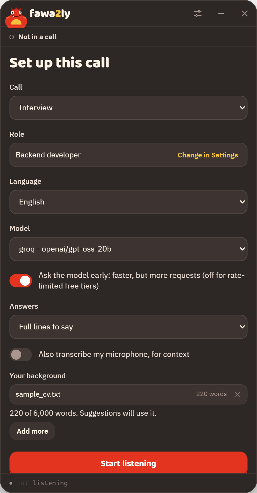<br><sub><b>Set up a call</b> in a few choices.</sub></td>
    <td align="center">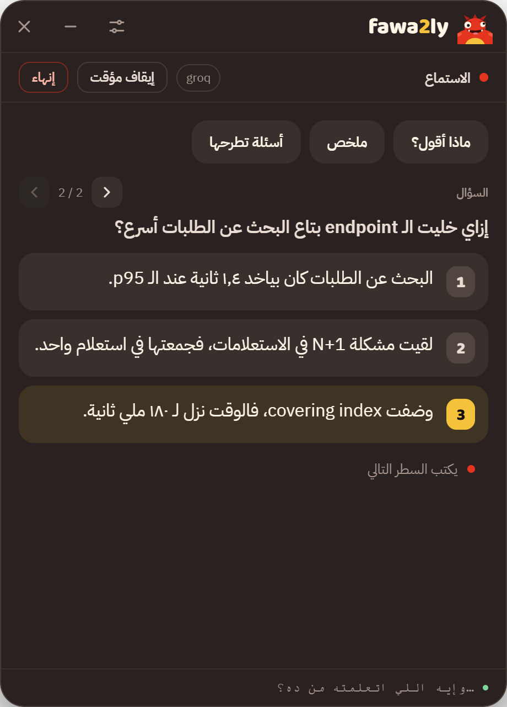<br><sub><b>بالعربي.</b> The whole app, right to left.</sub></td>
    <td align="center" valign="middle"><sub>The overlay is <b>always on top</b>, can be dragged anywhere, faded with an opacity slider, and made <b>click-through</b> so clicks reach the call underneath.</sub></td>
  </tr>
</table>

### Four looks

<p align="center">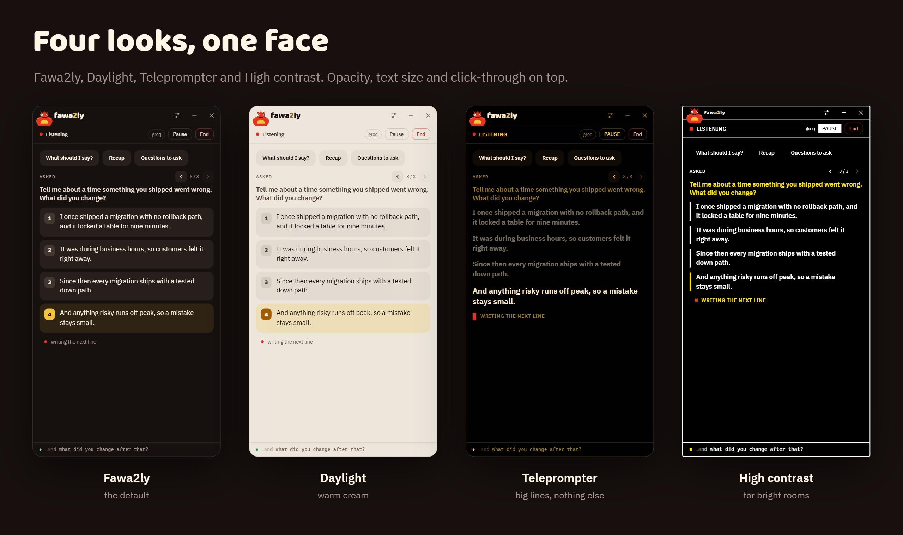</p>

### Settings

Everything else lives in one Settings window, in five groups.

<table>
  <tr>
    <td width="50%">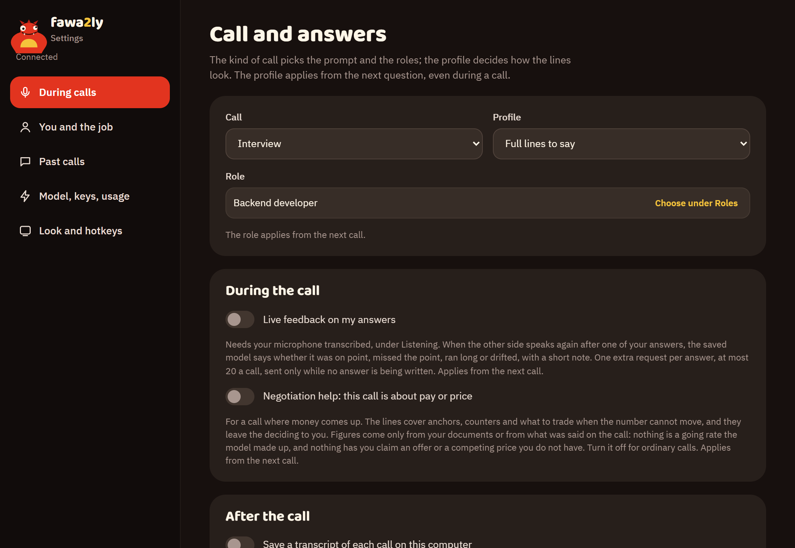<br><sub><b>During calls.</b> Call type, answer shape, live feedback, negotiation help, transcripts, and what it listens to.</sub></td>
    <td width="50%">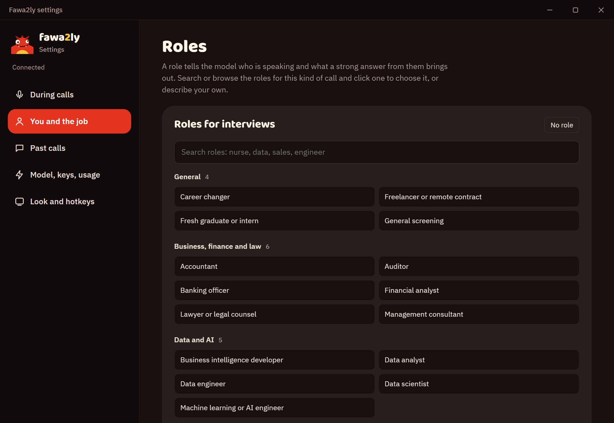<br><sub><b>You and the job.</b> 60+ searchable roles (or describe your own), your CV and documents, and a job-description check.</sub></td>
  </tr>
  <tr>
    <td>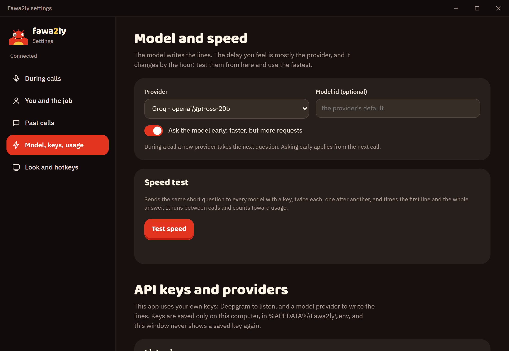<br><sub><b>Model, keys, usage.</b> Pick a provider, test which is fastest right now, manage keys, see token usage.</sub></td>
    <td>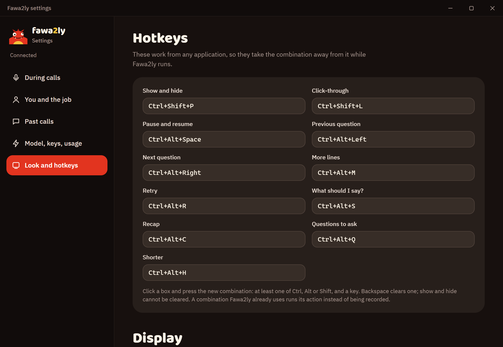<br><sub><b>Look and hotkeys.</b> Language, theme, text size, opacity, and every global hotkey.</sub></td>
  </tr>
</table>

## Features

**During the call**
- Listens to Windows system audio (the other side) and, optionally, your microphone.
- Detects questions and requests in English, Egyptian Arabic and Modern Standard Arabic, or "Auto"
  for English plus nine other languages.
- Streams 3 to 5 lines per question, typed in as they arrive, newest highlighted.
- Four answer shapes: **Full lines** to say, **Keywords** to glance at, **Direction** (how to shape
  the answer), or **Dynamic**, which picks the best of the three per question.
- On demand: What should I say?, Recap, Questions to ask, Shorter, More, Retry. Each has a hotkey.
- Move back and forth between questions; earlier ones stay one click away.
- Optional live feedback on your own answer (on point, missed the point, ran long, drifted), and a
  speaking-pace meter (words per minute and filler words), both from your microphone.
- Negotiation help for calls about pay or price: anchors, counters and trades, and it never invents
  a figure.
- Switch model mid-call; the next question uses it.

**Your documents and your role**
- CVs, portfolios and agendas as text, Markdown, PDF or Word, kept per call type.
- Without a document it says so, and writes *how to approach* the question instead of inventing
  facts.
- 60+ role presets across interviews and meetings, searchable, or describe your role in your own
  words (typed or spoken) and it is written up as a new preset.
- Paste a job description to see what matches your CV, what is missing and what to prepare.

**After the call**
- A summary: length, questions heard and answered, your pace.
- An optional saved transcript (off by default), listed under Past calls.
- A scored review of how each answer landed, with what went well and what to do next time.
- Meeting notes: summary, decisions, action items and open questions, copyable as Markdown.

**Models and providers**
- Cloud: Groq, Google Gemini, Cerebras, OpenAI, Anthropic Claude, OpenRouter, Mistral, DeepSeek,
  xAI Grok, Together AI, Fireworks AI.
- Local: Ollama, LM Studio, llama.cpp server, vLLM, Jan, or any OpenAI-compatible endpoint you add.
- A built-in speed test times the first line on every model with a key, so you can use the fastest.
- Listening: Deepgram in the cloud, or local Whisper (tiny to medium) with no key at all.

**The overlay**
- Always on top, draggable, adjustable opacity (only the background fades, never the text).
- Click-through, so the call underneath gets your clicks.
- Four themes (Fawa2ly, Daylight, Teleprompter, High contrast) and three text sizes.
- English or Arabic interface, right to left in Arabic, switched at once in both windows.
- The mascot is the status light: listening, thinking, answering, or knocked flat when something
  broke.

**Updates**
- The app shows its version and checks for a new one when it starts and every six hours.
- A new version is offered between calls, never during one, with what is new in it, and installs
  with one click: the app closes, updates and reopens by itself.
- Every update is signed, and the app refuses one whose signature does not match.

## Hotkeys

They work from any app while Fawa2ly runs, and every one can be changed in Settings.

| Action | Default | | Action | Default |
|---|---|---|---|---|
| Show / hide the overlay | `Ctrl` `Shift` `P` | | What should I say? | `Ctrl` `Alt` `S` |
| Click-through on / off | `Ctrl` `Shift` `L` | | Recap | `Ctrl` `Alt` `C` |
| Pause / resume | `Ctrl` `Alt` `Space` | | Questions to ask | `Ctrl` `Alt` `Q` |
| Previous question | `Ctrl` `Alt` `←` | | More lines | `Ctrl` `Alt` `M` |
| Next question | `Ctrl` `Alt` `→` | | Shorter | `Ctrl` `Alt` `H` |
| | | | Retry | `Ctrl` `Alt` `R` |

## Privacy, stated plainly

| What | Where it goes |
|---|---|
| Call audio | Streamed to Deepgram **only** if you use Deepgram for listening. Never stored. With local Whisper it stays on the machine. |
| Speaking a role (Settings > Roles > Speak) | Your microphone is streamed to Deepgram for up to a minute, only while you speak. Refused when listening is set to this computer: type the role instead. |
| What was said, your documents | Sent to the model provider you chose, to write the lines. With a local model (Ollama, LM Studio, …) nothing leaves the machine. |
| Settings, documents, API keys | Plain files in `%APPDATA%\Fawa2ly` (`~/.fawa2ly` elsewhere). Keys are in `.env` there, and a saved key is never shown again. |
| Transcripts and call logs | Written **only** if you turn on "Save a transcript of each call". Off by default. |
| First use of local Whisper | The model downloads once from Hugging Face (about 480 MB for the default size). |
| Update check | When it starts and every six hours, the app downloads one small file (`latest.json`) from this repository's GitHub releases to see if there is a newer version. That request carries nothing about you or your calls; GitHub sees it like any download. |
| Fonts | Each window loads its two typefaces (Baloo Bhaijaan 2, IBM Plex Sans Arabic) from Google Fonts when it opens, so Google sees your IP address and browser details, as for any web font. Offline, the system font is used. |
| Telemetry | None. Apart from the update check and the fonts, the app contacts nothing you did not choose. |

The engine listens on `127.0.0.1` only. Web pages cannot use it, but other programs on this
computer can, including programs of another Windows user signed in at the same time: see
[SECURITY.md](SECURITY.md).

## What it will not do

Fawa2ly shows its overlay to you, and the person you are talking to can be told it is there. It
will not hide itself from screen sharing, recordings, proctoring software or the taskbar, and it will
not stream the call to a hidden second listener. Those are project policy, not missing features:
see [CONTRIBUTING.md](CONTRIBUTING.md). Recording and assistance rules differ by country, employer
and interview; know the ones that apply to you before you use it.

## Install (Windows)

1. Download the latest `Fawa2ly_*_x64-setup.exe` from the [Releases](../../releases) page, with its
   `.sha256` file to check it.
2. Run it. The installer is not code-signed yet, so Windows shows *"Windows protected your PC"*:
   choose **More info**, then **Run anyway**. It installs for the current user and needs no
   administrator rights.
3. Open Fawa2ly. The installed app starts its own engine; no Python or terminal needed.

You only install once. When a new version comes out, Fawa2ly shows **Fawa2ly x.y.z is ready** on
its setup screen; press **Update and restart**. Your settings, documents and keys stay as they
are. You can also check any time in Settings > Look, hotkeys, updates.

## Your first call

1. **Add a key.** Open Settings (the sliders icon) → **Model, keys, usage**. Paste a key for one
   model provider (Groq and Gemini have free tiers), and a Deepgram key if you want cloud listening.
   Or choose local Whisper and a local model and skip keys entirely.
2. **Tell it who you are.** **You and the job** → pick your role and add your CV. Paste the job
   description if you have it.
3. **Pick what it hears.** If your meeting app plays through a headset rather than the Windows
   default, choose that device under **During calls**.
4. **Start.** In the overlay, choose Interview or Meeting, the call's language and the answer shape,
   then press **Start listening**. Join your call; lines appear the moment a question is heard.
5. **After.** Press **End** for the summary. With transcripts on, open **Past calls** to review it.

Something not working? The engine writes `%APPDATA%\Fawa2ly\engine.log`, and from the install
folder `engine\fawa2ly-engine.exe doctor --offline` checks the setup with no key and no network.

## Run it from source

You need Python 3.11+ and, for the desktop window, Rust (MSVC toolchain on Windows) and Node.

```bash
python -m pip install -r requirements.txt
python -m fawa2ly.doctor --offline          # checks the setup with no key and no network
```

Put keys in a `.env` file in the project folder, or paste them into Settings later:

```
DEEPGRAM_API_KEY=...        # listening (skip it with local Whisper)
GROQ_API_KEY=...            # or GEMINI_API_KEY, CEREBRAS_API_KEY, OPENAI_API_KEY, ...; local models need none
```

Start the engine and the window:

```bash
python -m fawa2ly.server --idle             # waits for the window to start a call
cd app && npm install && npm run tauri dev
```

The UI is plain HTML, CSS and JS, so for UI work you can skip Tauri and use a recorded call with no
microphone, key or model spend:

```bash
python -m fawa2ly.synth docs/eval/scripts/flutter-junior-en.yaml -o demo.raw.jsonl
python -m fawa2ly.server --replay demo.raw.jsonl --suggest --fake-llm
python -m http.server 5173 --directory app/src      # then open http://127.0.0.1:5173/index.html
```

Build the installer: see [app/README.md](app/README.md#building-the-installer). Publish a release,
which every installed copy then offers as an update: see [docs/RELEASING.md](docs/RELEASING.md).

## Under the hood

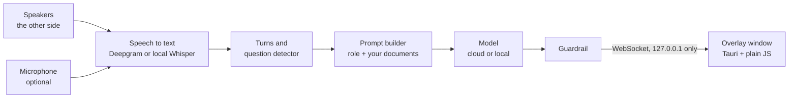

A Python engine does all the work; the Tauri window only draws the JSON events it receives and sends
commands back. The same engine runs with a console front end, in replay, and under the tests with
fake speech-to-text and a fake model. The product metric is the time from the end of a question to
the first line on screen, and every stage is timestamped to measure it.

| | |
|---|---|
| `fawa2ly/` | The engine: audio, speech to text, turn detection, prompts, providers, summaries, reviews. |
| `presets/` | The 60+ role presets (YAML). |
| `app/src/` | The window: `index.html` (overlay), `settings.html`, `styles.css`, `i18n.js` (Arabic). |
| `app/src-tauri/` | The Rust shell: frameless window, global hotkeys, starting the packaged engine. |
| `packaging/` | The PyInstaller spec for the engine and its `doctor` health check. |
| `docs/` | [Architecture](docs/ARCHITECTURE.md), releasing, the evaluation set, and the README media. |

More on the window, hotkeys and the installer: [app/README.md](app/README.md).

### Tests

```bash
python -m pytest -q
```

Over 400 tests, none needing a network, a key or an audio device. Off Windows, the one test that
needs the Windows audio library is skipped.

### The README media

The screenshots and the GIF are rendered from the real app pages by
[docs/media/source/capture.py](docs/media/source/capture.py), so they can be regenerated after any
design change; its header lists what to run first.

## Status and known limits

- **Windows only** for live audio. The engine, tests and replay tools run anywhere Python does. A
  macOS or Linux capture backend is the most useful contribution anyone could make (the capture code
  is in `fawa2ly/engine.py`).
- **Not code-signed** yet, hence the SmartScreen warning. Check the `.sha256` next to each download.
- **Local Whisper** is slower than Deepgram by design (a question is judged only once you stop
  speaking) and has had little testing in the installed app.
- **Early software.** The installer has been tried by few people so far. Issues and reports are
  welcome.

## Terms and license

Using the app is covered by the [Terms of Use](TERMS.md) (a draft that still needs review). No
source-code license has been chosen yet, so until one is added the code is visible but no
permission to copy, modify or redistribute it is granted. See [CHANGELOG.md](CHANGELOG.md) for
what changed in each release.
